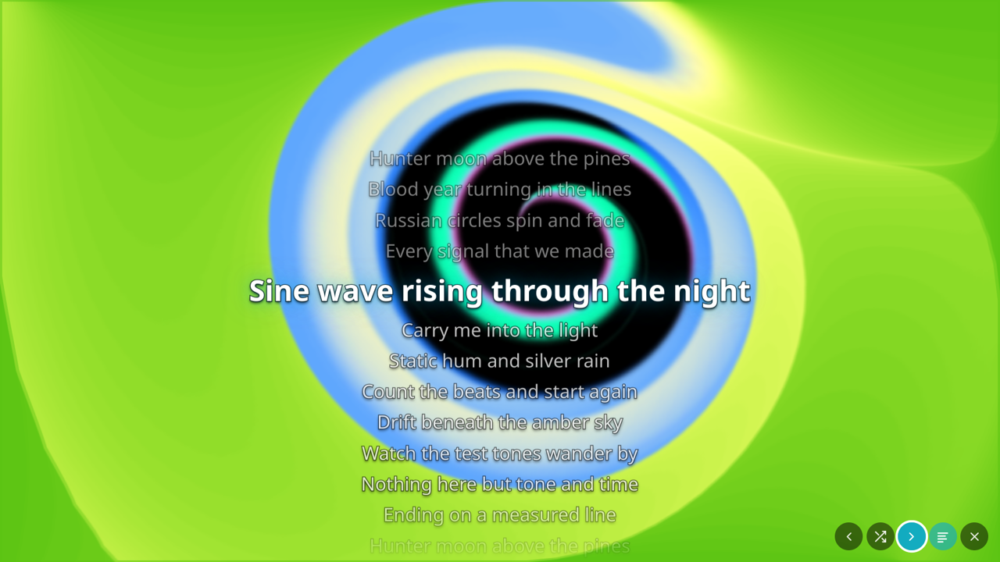

# Jellybutter

A [Butterchurn](https://github.com/jberg/butterchurn) (MilkDrop 2, WebGL) music visualizer inside the
Jellyfin web client, and inside Jellyfin Desktop. One server plugin, installed once from a plugin
repository, updated from there; nothing to install on any client.




## What it does

- A **visualizer button** in the Now Playing controls, between Lyrics and Shuffle, styled like
  jellyfin-web's own buttons. On every other page a round floating button appears at the bottom right
  while a track is loaded; its bars bounce while music plays. Both are real buttons, so jellyfin-web's
  arrow-key (D-pad) navigation reaches them; both can be switched off.
- The visualizer opens **full screen**: a random preset to start, a new one every 30 seconds (setting),
  2.7 seconds of blend between presets (setting), and the preset's name shown for 3 seconds on each change.
- A **lyrics view** lays the track's lyrics over the visualizer, readable over any preset (dark outline,
  drop shadow, accent glow on the current line). Lyrics come from Jellyfin's own Lyrics API, so whatever
  feeds the web client's lyrics page (sidecar `.lrc`/`.txt` files, the LrcLib plugin) feeds this too.
  Synced lyrics follow the music: the current line is large and centered, past lines dimmed above,
  upcoming lines below, with a smooth move on every change. Unsynced lyrics (plain text, no timestamps)
  cannot follow the music, so they sit still, whole, sized down or set in columns to fit the screen, with
  an "Unsynced lyrics" badge in the corner. A
  `.lrc` file with `[mm:ss.xx]` times gives synced lyrics. A setting picks whether the visualizer
  opens with or without lyrics; `l` or the Lyrics button toggles them while it is open.
- The web client's own **Now Playing bar** (artwork, track, artist, playback controls, volume) stays along
  the bottom of the visualizer, live, from whichever page it was opened (setting, on by default). The TV
  layout has no Now Playing bar of its own, so there the visualizer shows one: artwork, track, artist and
  album, previous, rewind, play/pause, fast forward and next, and the time.
- **D-pad and controller:** while the visualizer is open, the arrow keys, a remote's D-pad, or a gamepad
  (with jellyfin-web's "Enable gamepad" setting, or a Steam Input layout sending arrows, Enter and
  Escape) wake the on-screen controls and move between them and the Now Playing bar's buttons; Enter or A
  presses, Back, Escape or B closes.
- **Hotkeys:** `v` toggles the visualizer, `l` toggles lyrics, `b` next preset, `n` previous preset,
  `Escape` closes. A Steam Input layout that maps paddles to `v`, `b` and `n` drives it from a
  controller. On-screen buttons for previous, random, next, lyrics and close appear on hover or on any
  key, and fade after a moment.
- **Jellyfin Desktop:** the desktop client plays music through mpv, which a web page cannot hear. With the
  "Play music in the web player on Jellyfin Desktop" setting (on by default) the plugin hides the mpv
  audio player from the web client, so music plays through the web player and the visualizer hears it.
  Video stays on mpv. Audio output is unchanged: the web view plays to the system's default sink.
- **Self-contained:** the plugin serves the Butterchurn engine and presets itself. Nothing is loaded from
  a CDN, so it works on a LAN with no internet.

## Install

The one manual step: add the plugin repository to your server.

1. Dashboard > Plugins > Repositories > **+**
2. Name: `Jellybutter`, URL: `http://<forgejo-host>/rappo/jellybutter/raw/branch/main/manifest.json`, with
   the address of the Forgejo that hosts this repository
3. Dashboard > Plugins > Catalog > **Jellybutter Visualizer** > Install, then restart the server.

Jellyfin checks the repository for updates on its own schedule and installs them like any other plugin.

Requires Jellyfin 12.2 or later (target ABI 12.2.0.0).

Up to 1.1.0.0 the plugin was called **Milkdrop Visualizer** and lived at `rappo/jellyfin-plugin-milkdrop`. A
server with the old repository URL keeps updating (Forgejo redirects the old path); 1.2.0.0 copies the old
settings over on its first start. Point the repository at the URL above when convenient.

## Settings

Dashboard > Plugins > Jellybutter Visualizer.

| Setting | Default | Meaning |
| --- | --- | --- |
| Add the visualizer to the web client | on | The master switch. Off, the web client is served untouched and the plugin's files answer 404. |
| Play music in the web player on Jellyfin Desktop | on | Hide mpv's audio player from the web client so music plays through the web player (video stays on mpv). |
| Change preset every (seconds) | 30 | 0 keeps a preset until you change it. |
| Blend between presets (seconds) | 2.7 | 0 switches instantly. |
| Visualizer button in the Now Playing controls | on | The icon button between Lyrics and Shuffle. |
| Floating visualizer button on other pages | on | The round button at the bottom right wherever the Now Playing controls are not on screen. |
| Now Playing bar under the visualizer | on | jellyfin-web's playback bar along the bottom while the visualizer is open (the visualizer's own in the TV layout). |
| Opens as | Visualizer only | Or "Visualizer with lyrics". `l` switches lyrics on and off either way. |
| Lyrics text size | Medium | Small, Medium or Large. |

Settings take effect on the next page load of the web client (a reload, or reopening the desktop client).

## How it works

Jellyfin gives plugins no hook into the web client, and `index.html` on disk is replaced by every server
update, so the plugin rewrites it **at request time**: an ASP.NET startup filter puts a middleware ahead
of the static-file handler that buffers only the `index.html` response and appends one `<script>` tag
before `</body>`. The tag carries the settings as JSON in a data attribute and loads the client script
from the plugin, with the plugin version as a cache buster. Everything else passes through untouched.

The client script (plain JavaScript) watches for jellyfin-web's `<audio>` element, routes it through a Web
Audio graph the first time the visualizer opens (an element's output can only be captured once, so the
graph is built once per element), and lazy-loads the two Butterchurn bundles from the plugin on that first
open. Butterchurn 2.6.7 and butterchurn-presets 2.4.7 are pinned in `package.json`, copied from
`node_modules` by the build and embedded in the DLL.

The Now Playing button is inserted into jellyfin-web's own button row as the same kind of element
(`paper-icon-button-light`, a Material icon), and put back whenever jellyfin-web rebuilds the row. The
lyrics view reads the track id out of the audio element's URL and fetches `Audio/{id}/Lyrics` through the
web client's own API client, once per track; synced lines are chosen by the audio element's current time
on every frame while the visualizer is open.

## Development

See [AGENTS.md](AGENTS.md) for the layout, build, tests, release and the lessons learned.

```bash
npm ci && npm test && dotnet test
```

## License

MIT. Butterchurn and butterchurn-presets are MIT, (c) Jordan Berg; the presets carry their authors' names.
Their license texts ship in every release as `THIRD-PARTY-NOTICES.txt`.
