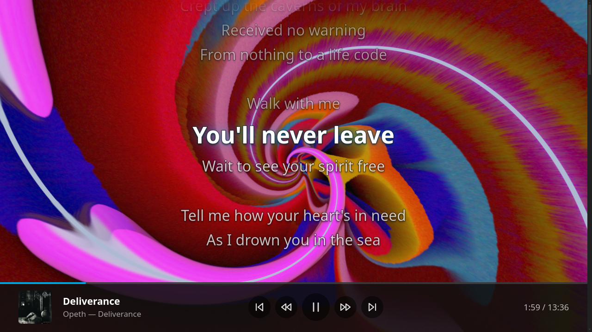
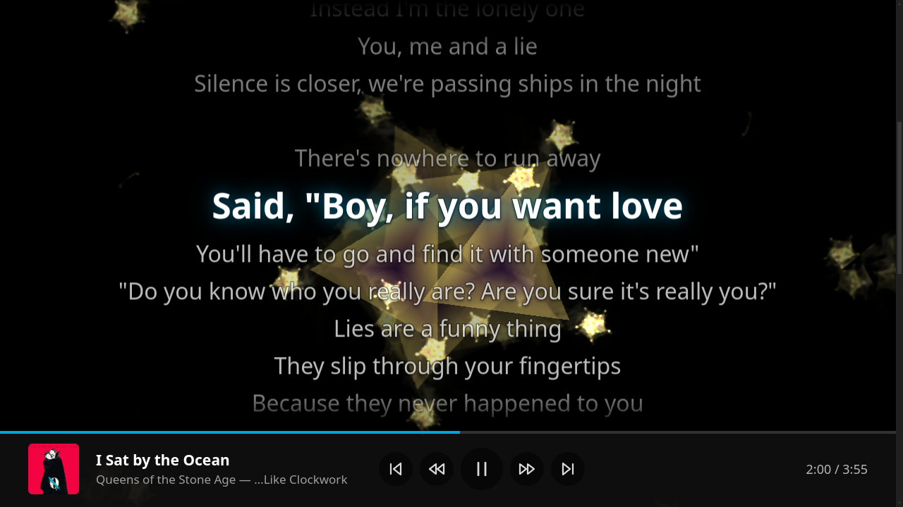
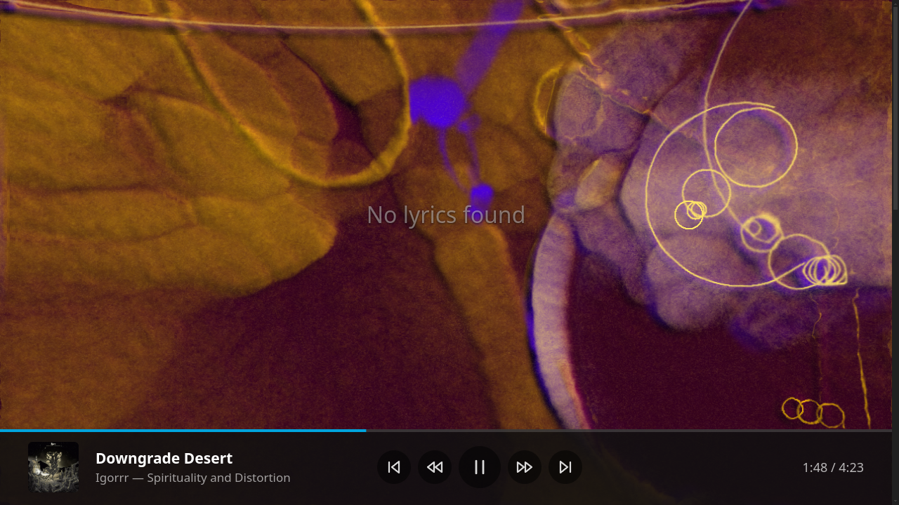

# Jellybutter

A [Butterchurn](https://github.com/jberg/butterchurn) (MilkDrop 2, WebGL) music visualizer inside the
Jellyfin web client, and inside Jellyfin Desktop. One server plugin, installed once from a plugin
repository, updated from there; nothing to install on any client.

## Screenshots







## What it does

- **Full-screen MilkDrop visualizer** with auto-cycling presets, opened from a button in Now Playing or a
  floating button anywhere else.
- **Lyrics over the visualizer:** synced lyrics follow the music; plain lyrics show still, fitted to the
  screen.
- **Now Playing bar** under the visualizer: track, artwork, controls and progress.
- **TV and controller friendly:** D-pad, remote or gamepad. Back hides the UI, a second Back closes.
- **Idle mode:** opens by itself after 2 minutes of music with no input.
- **Hotkeys:** `v` visualizer, `l` lyrics, `b`/`n` next/previous preset.
- **Jellyfin Desktop:** routes music through the web player so the visualizer can hear it; video stays on
  mpv.
- **Self-contained:** no CDN, works offline.

## Install

The one manual step: add the plugin repository to your server.

1. Dashboard > Plugins > Repositories > **+**
2. Name: `Jellybutter`, URL: `https://raw.githubusercontent.com/rappo/jellybutter/main/manifest.json`
3. Dashboard > Plugins > Catalog > **Jellybutter Visualizer** > Install, then restart the server.

Jellyfin checks the repository for updates on its own schedule and installs them like any other plugin.

Requires Jellyfin 12.2 or later (target ABI 12.2.0.0).

Up to 1.1.0.0 the plugin was called **Milkdrop Visualizer**. It keeps the same plugin id, so Jellyfin treats
Jellybutter as an update, and 1.2.0.0 copies the old settings over on its first start.

## Settings

Dashboard > Plugins > Jellybutter Visualizer.

| Setting | Default | Meaning |
| --- | --- | --- |
| Add the visualizer to the web client | on | The master switch. Off, the web client is served untouched and the plugin's files answer 404. |
| Play music in the web player on Jellyfin Desktop | on | Hide mpv's audio player from the web client so music plays through the web player (video stays on mpv). |
| Change preset every (seconds) | 30 | 0 keeps a preset until you change it. |
| Blend between presets (seconds) | 2.7 | 0 switches instantly. |
| Visualizer button in the Now Playing controls | on | The icon button between Lyrics and Shuffle. |
| Floating visualizer button on other pages | on | The round button at the bottom right wherever the Now Playing controls are not on screen. |
| Now Playing bar under the visualizer | on | jellyfin-web's playback bar along the bottom while the visualizer is open (the visualizer's own in the TV layout). |
| Opens as | Visualizer only | Or "Visualizer with lyrics". `l` switches lyrics on and off either way. |
| Lyrics text size | Medium | Small, Medium or Large. |
| Open the visualizer when idle | on | While music plays and nothing is pressed for the idle time, the visualizer opens by itself. |
| Idle time (minutes) | 2 | 1 to 60. |
| Hide the controls when it opens | on | The idle visualizer shows only the track, artwork, time and progress until a key is pressed. |

Settings take effect on the next page load of the web client (a reload, or reopening the desktop client).

## How it works

Jellyfin gives plugins no hook into the web client, and `index.html` on disk is replaced by every server
update, so the plugin rewrites it **at request time**: an ASP.NET startup filter puts a middleware ahead
of the static-file handler that buffers only the `index.html` response and appends one `<script>` tag
before `</body>`. The tag carries the settings as JSON in a data attribute and loads the client script
from the plugin, with the plugin version as a cache buster. Everything else passes through untouched.

The client script (plain JavaScript) watches for jellyfin-web's `<audio>` element, routes it through a Web
Audio graph the first time the visualizer opens (an element's output can only be captured once, so the
graph is built once per element), and lazy-loads the two Butterchurn bundles from the plugin on that first
open. Butterchurn 2.6.7 and butterchurn-presets 2.4.7 are pinned in `package.json`, copied from
`node_modules` by the build and embedded in the DLL.

The Now Playing button is inserted into jellyfin-web's own button row as the same kind of element
(`paper-icon-button-light`, a Material icon), and put back whenever jellyfin-web rebuilds the row. The
lyrics view reads the track id out of the audio element's URL and fetches `Audio/{id}/Lyrics` through the
web client's own API client, once per track; synced lines are chosen by the audio element's current time
on every frame while the visualizer is open.

## Development

See [AGENTS.md](AGENTS.md) for the layout, build, tests, release and the lessons learned.

```bash
npm ci && npm test && dotnet test
```

## License

MIT. Butterchurn and butterchurn-presets are MIT, (c) Jordan Berg; the presets carry their authors' names.
Their license texts ship in every release as `THIRD-PARTY-NOTICES.txt`.
